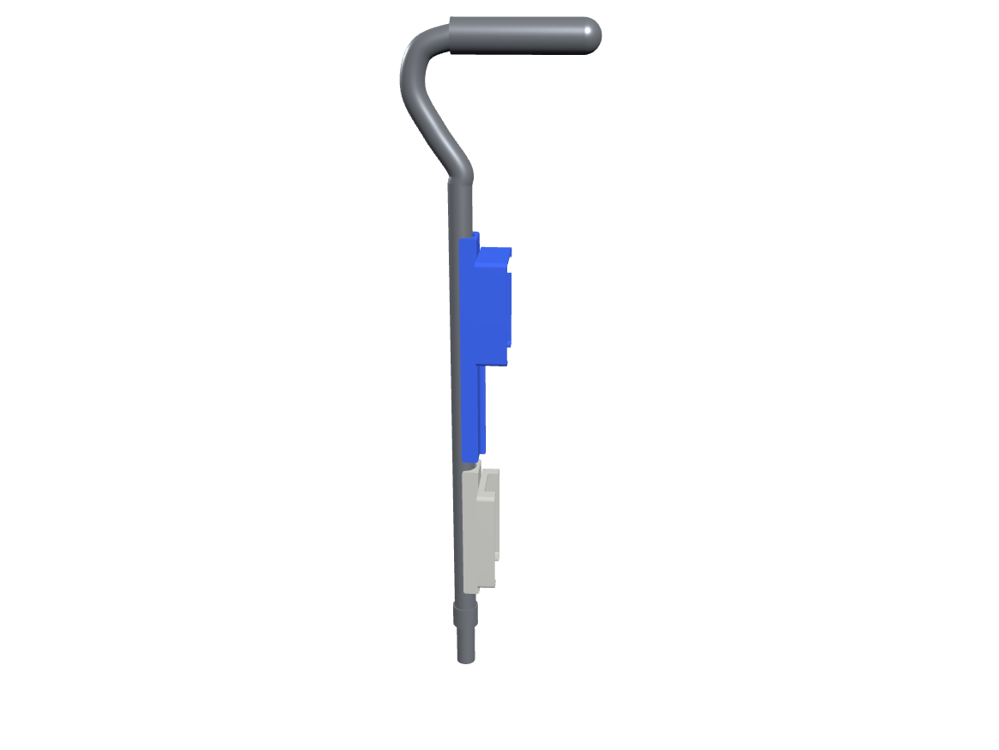
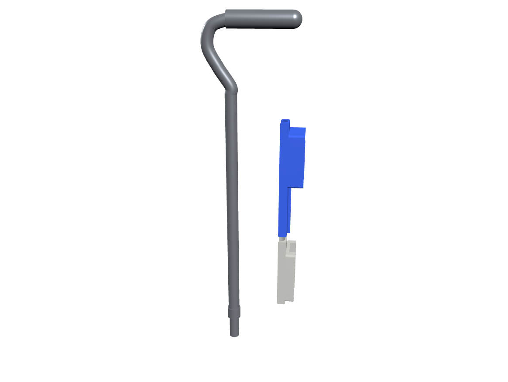

# Hardware

## Printed parts

Two parts are printed and strapped to the cane's upper shaft. Nothing is drilled into the cane.

| File | What it is | Size (mm) |
|---|---|---|
| `cad/pi_cane_case.stl` | Case for the Raspberry Pi, with a long tail that lies along the shaft | 222 x 69 x 45 |
| `cad/bank_holder.stl` | Tray for the power bank | 138 x 70 x 34 |

Both files are in print orientation: tray opening up, flat on the bed.

Each part has a saddle underneath, an arch about 22 mm across, that sits on the 22 mm upper tube of the cane. Straps or zip ties around the end tabs hold it in place.

| Assembled | Pulled apart |
|---|---|
|  |  |

## Assembly model

`cad/assembly/` holds the same two parts moved into position on a cane, as three STL files that share one origin (z up, shaft on the z axis, millimetres). Open all three together in any STL viewer or slicer.

- `pi_case.stl` and `bank_holder.stl` are the printed parts, unchanged apart from being moved.
- `cane_reference.stl` is a plain stand-in for an offset-handle aluminium cane, cut off below the adjustment collar. It is there for context and is not measured from the real cane.
- The heights of the two parts along the shaft are illustrative.

## To fill in

- parts list with quantities and links
- pinout (which sensor connects to which pin)
